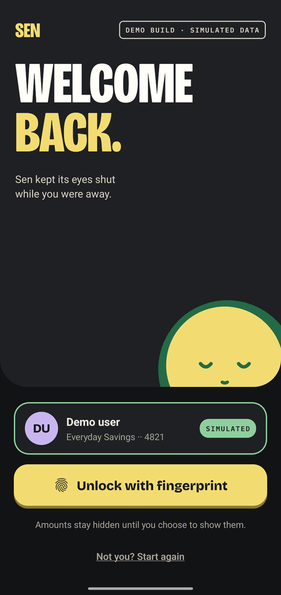
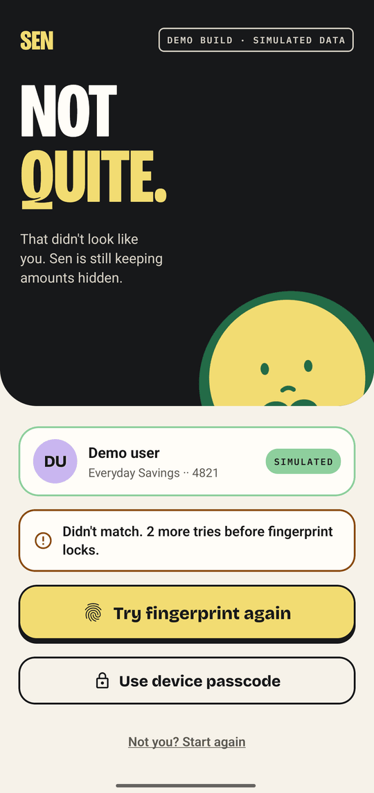
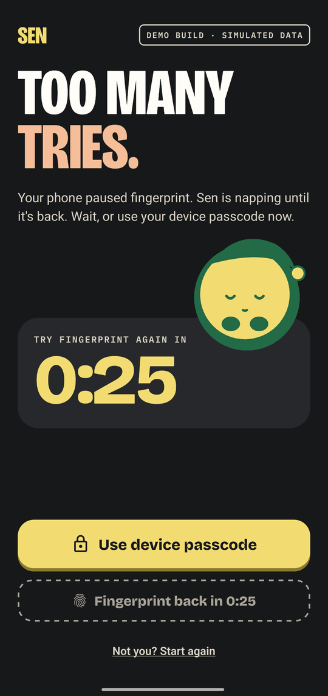

<p align="center">
  
</p>

# Sen

**A secure transaction history module for a fintech app.** Amounts stay hidden until the device's biometrics say it is you. React Native, TypeScript and an encrypted local database, with no backend. It is a take-home assignment, and the name comes from the sen, the Malaysian cent.


Sen the coin is the app's mascot. It keeps its eyes shut while amounts are hidden, and it is the friendly part of a security-first app. The security model comes first in this README and the mascot comes after.

## For reviewers

### Run it

**Option 1. Install the Android APK.** Download `sen-1.0.0.apk` from the [latest GitHub release](https://github.com/Kaiz404/sen/releases/latest) and install it. Enrol a fingerprint (or face unlock) on the device first. Android asks for a screen lock before it enrols one. No account or other tool is needed. <!-- pending: lane release (the owner creates the GitHub release and attaches the APK) -->

**Option 2. Run from source.** You need Node 22.13 or later, JDK 17 and the Android SDK.

```bash
npm install
npx expo run:android
```

`npx expo run:android` builds a development build and installs it on the connected device or emulator. Expo Go does not work, because Sen uses native modules (SQLCipher, MMKV) that Expo Go does not ship. Sen is Android-first. The code also targets iOS, but the author had no Mac, so iOS is untested.

### Simulate biometrics

- **Emulator.** Set a screen PIN and enrol a fingerprint in the emulator's Settings. When Sen shows the fingerprint prompt, run `adb -e emu finger touch 1`.
- **Real device.** Touch the sensor, or use the face unlock you enrolled.
- **No biometrics on the device.** Tap **Use device passcode** on the Lock screen.

### Take the two-minute tour

1. Open Sen and tap **Continue as demo user**, then unlock. History opens with every amount hidden.
2. Tap **Show amounts**. Sen asks for biometrics first.
3. Pull down to refresh, search for `Grab`, and switch between **All**, **In** and **Out**.
4. Open Settings, scroll to **For reviewers** and force a failure (next table).
5. Lock the app and reopen it. Add a transaction and delete it again. Each write asks for biometrics.

### Break it on purpose

Settings has a **For reviewers** section (stamped **DEMO ONLY**). It shapes the fake bank's answers, so every error state is one tap away. The controls ship in the release APK. They cannot pass a biometric check, show an amount or skip step-up (see threat T13 in [ARCHITECTURE.md](ARCHITECTURE.md#threat-model)).

| Control | What it does | How you recover |
| --- | --- | --- |
| **Next history request** › Offline | The next history request fails as if the network were down. History shows the offline state. | Tap **Retry**, or pull to refresh. The fault covers one request, then reads Normal again. |
| **Next history request** › Timeout (8 s) | The request hangs for 8 seconds, then fails. | Same as Offline. |
| **Next history request** › Server error 500 | The request fails with a server error. | Same as Offline. |
| **Next history request** › Bad data | The bank answers with rows that break the schema. Sen drops them and counts them. | Retry. The valid rows still show. |
| **Dataset size** (20, 1k, 10k) | Reloads the sample data at the chosen size. Rows you added stay. | Choose another size at any time. |
| **Slow network, add 3 s** | Every request takes 3 seconds longer. | Switch it off. |
| **New transaction on refresh** | The next pull to refresh brings one new row. | Switch it off. |
| **Simulate fingerprint lockout** (or face unlock, as the device has it) | The next unlock reports a lockout. Lock shows a cool-down and offers the device passcode. | Tap the row again, or tap **Undo** in the toast, to disarm it. |
| **Reset demo data** | Restores the sample data and every control above to its default. Security settings and rows you added stay. | Nothing to recover. Cancel the sheet to change nothing. |

## What Sen protects, and what it does not

Sen has no server, so everything it protects is on the phone. [ARCHITECTURE.md](ARCHITECTURE.md#threat-model) holds the full threat model, T1 to T13, with the file and the test behind each row.

| Threat | Control | Where |
| --- | --- | --- |
| Someone holding the unlocked phone | Lock on launch, protected routes, biometric step-up for every write (add, delete), idle lock, lock after the app leaves the foreground | `src/app/_layout.tsx`, `src/features/auth/` |
| Shoulder surfing | Amounts are masked by default. Showing them needs biometrics | `src/features/transactions/` |
| Data at rest | SQLCipher database. The key sits in `expo-secure-store`, set to this device only, and Android backup is off (`allowBackup: false`) | `src/services/vault.ts`, `app.config.ts` |
| Amounts leaking out of the app | Masked view models carry `amount: null`, so no amount reaches JavaScript while hidden, and a test proves it. Logs take event codes only. The clipboard gets the reference only | `src/features/transactions/masking.test.tsx`, `src/services/logger.ts` |
| Deep links that skip the lock | Protected routes are not mounted while locked | `src/__tests__/guard.test.tsx` |
| Malformed or hostile input | A custom keypad, integer sen instead of floats, zod limits and a text sanitiser | `src/features/add/`, `src/services/sanitize.ts` |
| Tampered or corrupt data | Every read and every bank row passes a zod parse. Bad rows are dropped and counted | `src/services/tx-repo.ts`, `src/services/sync.ts` |
| A debug shortcut in a release build | The dev-only auth override compiles out. `npm run release:auth-check` greps a production bundle for it | `src/features/auth/prompt.ts`, `scripts/check-release-auth.sh` |
| Screenshots and the app-switcher preview | Screen capture blocked in release builds, and a privacy cover in the app switcher <!-- pending: lane guard --> | `src/features/security/` |
| Amounts after unlock | Every unlock and cold start lands masked, and showing takes one biometric check per session <!-- pending: lane remask --> | `src/features/auth/amounts.ts` |
| A local log of security events | An encrypted activity log of adds, deletes and undos, with an erase action <!-- pending: lane activity --> | `src/features/activity/` |

**What this does not protect against.**

- **A rooted or instrumented device.** The biometric result is a JavaScript boolean, so a hooked runtime can skip it. A production app would bind the key to the biometric or check a signed challenge on a server.
- **Amounts while they are shown.** They sit in JavaScript memory, the share sheet and the screen reader tree. Masking protects the hidden state only. Right now an amount you showed stays shown across a lock until you hide it again. <!-- pending: lane remask (this sentence goes when every unlock lands masked) -->
- **Root detection and certificate pinning.** Both are easy to patch, and there is no real server to pin.
- **iOS.** The code targets it and nobody has run it.

[DECISIONS.md](DECISIONS.md) records the alternatives for each choice, for example D1 (why SQLCipher), D6 (why masking happens in the query) and D27 (when amounts show).

## How the brief maps to the code

| Brief requirement | Where it lives |
| --- | --- |
| 1. Biometric authentication | Lock, primer and welcome screens in `src/features/auth/screens/`. Session state machine in `src/features/auth/machine.ts`. `src/features/auth/prompt.ts` maps every native error code, and an unknown one maps to `unknown`. Android uses fingerprint or face unlock by name, never "Face ID" |
| 2. At least 20 simulated JSON transactions | `src/services/seed.ts` is a seeded generator (20, 1,000 or 10,000 rows). `src/services/bank-api.ts` is the in-app mock bank with latency and faults. zod schemas in `src/models/transaction.ts` |
| 3. History with masked amounts, biometric reveal and pull to refresh | `src/features/transactions/` (list, month summary, search, filters), `reveal.tsx`, `src/features/auth/amounts.ts` |
| 4. Detail screen with every field | `src/features/detail/`, reached from `src/app/transaction/[id]/index.tsx`. Includes status timeline, copy reference and share receipt <!-- pending: lane l4a --> |
| 5. Error handling | A tagged-union `AppError` in `src/models/errors.ts`. Every error has a designed state: offline, timeout, server, bad data, lockout, cancelled prompt. Reproduce each with the reviewer controls above |
| 6. TypeScript, structure, separation of concerns | `src/models/` imports nothing. `src/services/` owns all I/O. `src/features/` holds logic and screens. `src/components/` holds design-system primitives. `src/app/` routes stay thin. ESLint enforces the layers |

## Features

Screens from a real Android phone. The top row is the light theme and the bottom row is the dark theme.

| Lock | Hidden amounts | Shown amounts |
| :---: | :---: | :---: |
|  |  |  |
|  |  |  |

- **Biometric login.** Fingerprint or face unlock, with a device passcode fallback. Every failure has a designed state, and a lockout shows a cool-down.
- **Masked by default.** Every amount is `RM` and four coins. One biometric check shows them. Settings can turn hiding off, which also asks for biometrics.
- **History.** Date-grouped receipt slips, a month summary, All, In and Out filters, live search over up to 10,000 rows and pull to refresh.
- **Add and delete your own transactions.** A custom keypad keeps amounts away from the system keyboard. Saving asks for biometrics. Added rows are stored encrypted and have Undo. Only added rows can be deleted, and bank rows are read-only.
- **Reviewer controls.** Every error state on demand, described above.
- **Craft.** Light, dark and system themes, haptics, a reduced-motion setting and screen reader labels such as "Amount hidden".
- **Detail screen.** Every field, a status timeline for pending items, copy reference and share receipt. <!-- pending: lane l4a -->
- **Security activity log.** An encrypted local log of security events, with an erase action. <!-- pending: lane activity -->

The failure states are as designed as the happy path:

| Wrong finger | Lockout cool-down |
| :---: | :---: |
|  |  |

## Sen's moments

Sen reacts to what the security layer is doing. These clips come from a physical phone in Full motion, and the **Sen's animations** setting offers Calm and Off. Sen's motion is data in `src/features/sen/moments/`, and Jest asserts literal values at the start, midpoint and end of each moment (`npm run test:motion`).

| Launch | Unlock | Show amounts | Hide again | Lockout nap |
| :---: | :---: | :---: | :---: | :---: |
|  |  |  |  |  |

## Testing

| Check | Command | What it covers |
| --- | --- | --- |
| Everything CI runs | `npm run check` | Typecheck, lint, the Jest suite and the performance benches |
| Unit and component tests | `npm test` | 1,283 tests in 80 suites on `jest-expo` and React Native Testing Library. The database runs real SQL through a `node:sqlite` adapter |
| Motion | `npm run test:motion` | Sen's moments and the shared components, at literal values |
| Release safety | `npm run release:auth-check` | The dev auth override is absent from a production bundle |

Tests call the code the way a user does. The security properties in [ARCHITECTURE.md](ARCHITECTURE.md#tests-d16) each have a named test, for example `masking.test.tsx` (no digit in the rendered tree while masked), `session.test.tsx` and `lock-flow.test.tsx`. The count above came from `npm test` on `main` when this README was written.

**On a real phone.** The author drives an arm64 Android phone with [Maestro](https://maestro.mobile.dev) flows from `.maestro/`, which agents use to verify their work. `npm run device:verify` runs every flow, and `npm run device:shots` captures every gallery screen into `shots/runs/<timestamp>/png`. Both need a phone set up as described in [CLAUDE.md](CLAUDE.md). The screenshots and clips on this page come from that loop, and `node scripts/media.mjs` crops them. The flows are not a shipped end-to-end suite, and the unit tests are the suite.

Rebuild the images on this page with `npm run icons`, `node scripts/media.mjs` and `node scripts/brand.mjs`.

## Decisions and docs

D1 to D27 in [DECISIONS.md](DECISIONS.md) compare the options for each choice and say why one won. The ones a reviewer asks about most:

| Question | Answer |
| --- | --- |
| Where do the transactions live? | An encrypted SQLite database (SQLCipher) is the source of truth. The mock bank syncs into it, and TanStack Query reads it (D1, D2) |
| How does masking work? | Masked queries never select an amount, so no amount reaches JavaScript while hidden (D6) |
| How does it handle 10,000 rows? | Keyset pages, SQL sums and FlashList v2 (D3, D7) |
| Why a tagged union for errors? | Every error is data, and the compiler checks every state has a screen (D15) |

| File | Covers |
| --- | --- |
| [ARCHITECTURE.md](ARCHITECTURE.md) | Stack, layers, state machine, storage, threat model, tests, builds |
| [DECISIONS.md](DECISIONS.md) | Alternatives compared and why each choice won |
| [DESIGN.md](DESIGN.md) | Visual system, Sen the mascot, motion, screens, flows, settings |
| [PLAN.md](PLAN.md) | Build order, parallel lanes and how each phase is verified |
| [CLAUDE.md](CLAUDE.md) | Working rules for coding agents on this repo |

The 20 or more simulated transactions come from an in-app mock API with realistic latency. There is no backend.
