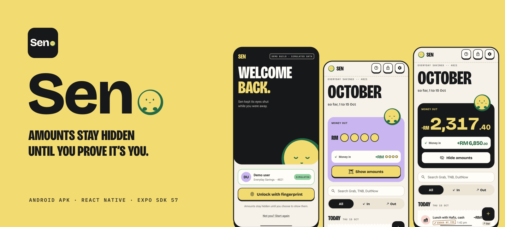
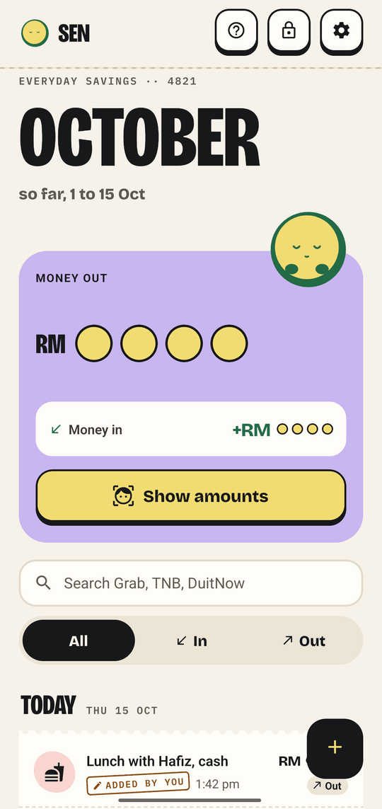
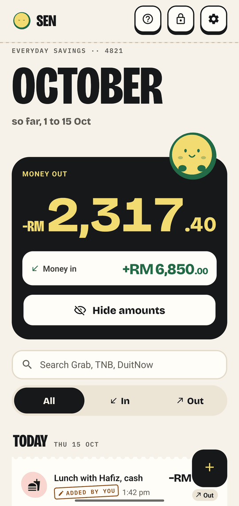
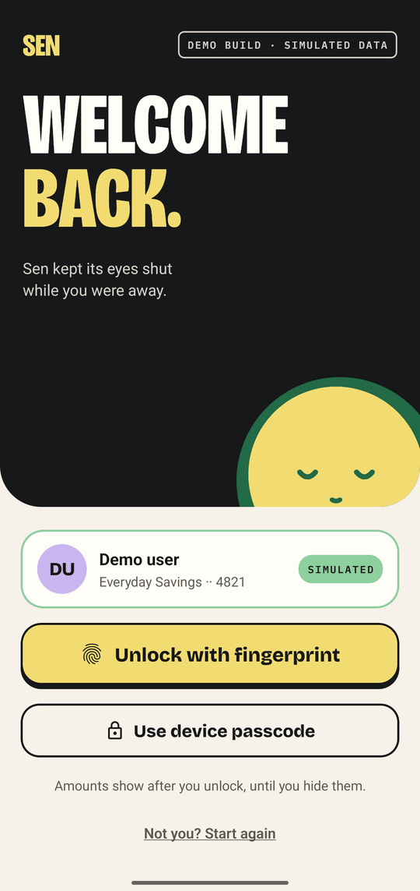
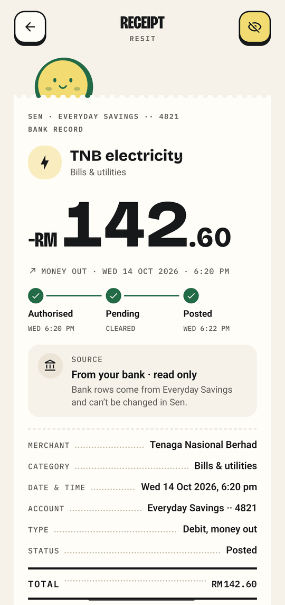
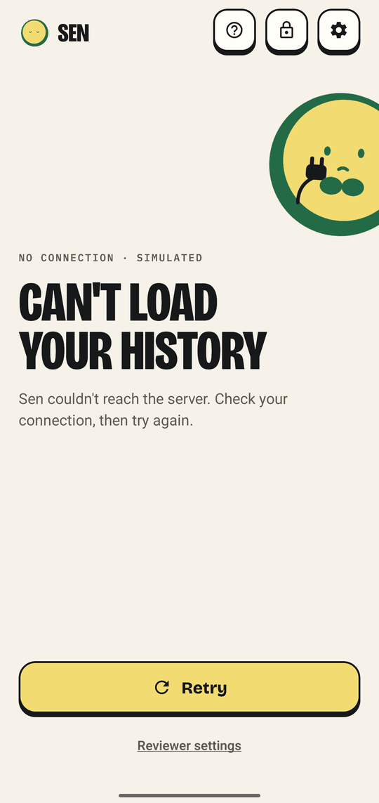
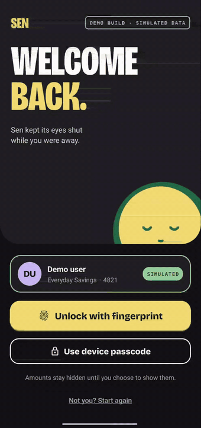
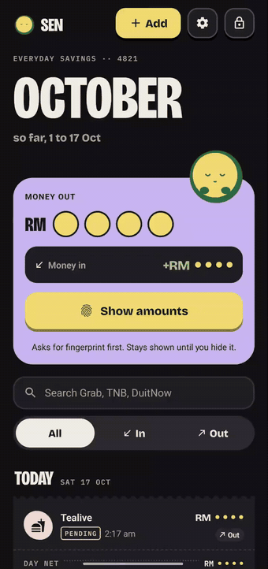

<p align="center">
  
</p>

# Sen

**A secure transaction history module for a fintech app.** Amounts stay hidden until the phone's biometrics or screen lock say it is you. React Native, TypeScript and an encrypted local database, with no backend. Built as a take-home assignment, and named after the sen, the Malaysian cent.


## Try it

**[Download the Android APK](https://expo.dev/artifacts/eas/TUTHE0mXzWeY1vqpsMw0MrUT1oPHnsCMuq4UPKUpIy4.apk)** (EAS preview build, about 135 MB). Allow installs from your browser when Android asks.

**You need** an Android phone with a screen lock (PIN, pattern or password). Sen refuses to run without one. A fingerprint or face unlock is better but optional. There is no account and no backend: the bank is a mock inside the app, so it works offline.

1. **Unlock.** Tap **Continue as demo user**, then **Unlock**. Android shows the biometric sheet, which also offers your screen lock.
2. **Masked, then reveal.** History opens with 1,000 sample rows, every amount shown as `RM` and four coins. Tap **Show amounts** and prove it is you. Amounts re-mask when Sen locks or restarts.
3. **Pull to refresh.** Open Settings (the cog) › **For reviewers** and switch on **New transaction on refresh**. Go back and pull down: a PENDING row arrives. Pull again two minutes later and it posts.
4. **Detail and errors.** Tap a row for every field and its status timeline. Then in **For reviewers** pick **Offline** under **Next history request**, pull to refresh, and tap **Retry**. Timeout, 500 and bad data work the same way.
5. **Add.** Tap **+**, enter an amount on Sen's own keypad, pick a date and save. Saving asks for biometrics, and the new row has Undo.

> [!NOTE]
> The **For reviewers** controls only shape the fake bank's answers. They cannot skip a biometric check or show an amount (threat T13 in [ARCHITECTURE.md](ARCHITECTURE.md#threat-model)).

## How the brief maps to the code

| Brief requirement | Where it is met |
| --- | --- |
| Biometric authentication | `src/features/auth/` (state machine, prompt, Lock screen). One Unlock key, no password inside Sen (D28, D40) |
| 20 or more simulated JSON transactions | `src/services/seed.ts` (20, 1,000 or 10,000 rows) and `src/services/bank-api.ts`, validated by zod in `src/models/transaction.ts` |
| History, masked amounts, biometric reveal, pull to refresh | `src/features/transactions/`, `src/features/auth/amounts.ts`. Pending rows post on a later refresh (D39) |
| Detail screen with every field | `src/features/detail/`, with status timeline, copy reference and share receipt |
| Error handling | Tagged-union `AppError` in `src/models/errors.ts`. Every error has a designed state and a way out |
| TypeScript and separation of concerns | `src/models/`, `src/services/`, `src/features/`, `src/components/` and thin `src/app/` routes. ESLint enforces the layers |

## Screenshots

| Hidden | Shown | Lock | Detail | Error |
| :---: | :---: | :---: | :---: | :---: |
|  |  |  |  |  |

| Unlock | Show amounts |
| :---: | :---: |
|  |  |

Dark theme, the Add flow and Sen's other moments are in [DESIGN.md](DESIGN.md).

## Security

- **Masked by default.** Masked queries never select an amount, so no amount reaches JavaScript while hidden. A test proves it (D6).
- **Gated.** Protected routes are not mounted while locked. Every write asks again for biometrics or the screen lock. Sen also locks when idle or when it leaves the foreground.
- **Encrypted at rest.** SQLCipher database, key in `expo-secure-store`, excluded from Android backup.
- **Release builds** block screenshots and recording and cover the app switcher (D30). A dev-only auth override compiles out, and `npm run release:auth-check` verifies it.
- **Untrusted input.** Integer sen, a custom keypad, zod parsing on every read and every bank row.

> [!IMPORTANT]
> The vault key is not bound to biometrics. The check is a JavaScript step-up in front of it, so a rooted or instrumented device can skip it (D14). Shown amounts sit in JavaScript memory. There is no root detection or certificate pinning, and nobody has run the iOS build. See the [threat model](ARCHITECTURE.md#threat-model).

## Tech stack

Expo SDK 57, React Native, TypeScript (strict), Expo Router, SQLCipher, TanStack Query, FlashList v2, zod, `jest-expo` with React Native Testing Library.

## Run from source

Needs Node 24 (`nvm use` reads `.nvmrc`), JDK 17 and the Android SDK.

```bash
npm install
npx expo run:android
```

> [!TIP]
> Expo Go does not work, because Sen has native modules. After you pull new commits, rebuild the dev client with `npx expo run:android` again, since local native modules such as `sen-auth` change with the code.

## Tests

`npm run check` runs the typecheck, lint, 1,781 Jest tests and the performance benches.

## Docs

| File | Covers |
| --- | --- |
| [ARCHITECTURE.md](ARCHITECTURE.md) | Layers, state machine, storage, threat model, tests |
| [DECISIONS.md](DECISIONS.md) | Alternatives compared and why each choice won (D1 to D40) |
| [DESIGN.md](DESIGN.md) | Visual system, the mascot, motion, screens, settings |
| [PLAN.md](PLAN.md) | Build order and how each phase is verified |
