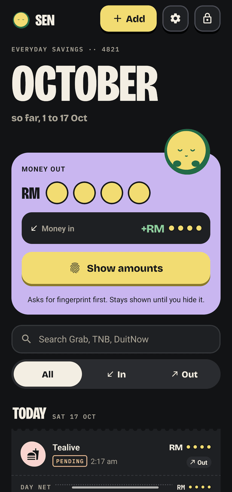
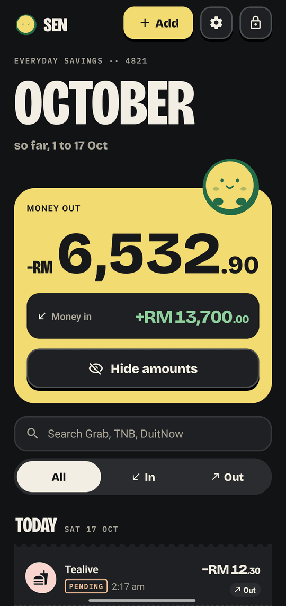
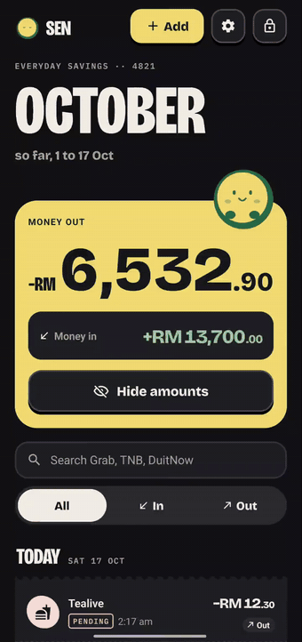

<p align="center">
  
</p>

# Sen

**A secure transaction history module for a fintech app.** Amounts stay hidden until the device's biometrics say it is you. React Native, TypeScript and an encrypted local database, with no backend. It is a take-home assignment, and the name comes from the sen, the Malaysian cent.


Sen the coin is the app's mascot. It keeps its eyes shut while amounts are hidden, and it is the friendly part of a security-first app. The security model comes first in this README and the mascot comes after.

## For reviewers

### Before you start

- **A phone with a screen lock.** Sen refuses to run on a phone with no PIN, pattern or password (D28), and shows one key that opens the lock-screen settings. A fingerprint or face unlock is better and not required. Without one, Sen goes straight to the screen lock.
- **Android.** Sen is Android-first and was built and checked on an arm64 phone. The code also targets iOS, which nobody has run.
- **No account, no backend.** The bank is a mock inside the app, so the app works offline from the first launch.

### Install

**Option 1. The release APK.** Download `sen-1.0.0.apk` from the [latest GitHub release](https://github.com/Kaiz404/sen/releases/latest) and install it. No other tool is needed. <!-- pending: lane release (the owner creates the GitHub release and attaches the APK) -->

**Option 2. A dev build with Metro.** You need Node 22.13 or later, JDK 17 and the Android SDK.

```bash
npm install
npx expo run:android
```

`npx expo run:android` builds a development build, installs it on the connected phone or emulator and starts Metro. Expo Go does not work, because Sen uses native modules (SQLCipher, MMKV, a clipboard module, a screen-lock module) that Expo Go does not ship. A dev build leaves screenshots and recording open so agents can capture the app. The release APK blocks them.

On an emulator, set a screen PIN and enrol a fingerprint in the emulator's Settings. When Sen shows the fingerprint sheet, run `adb -e emu finger touch 1`.

### A five-minute guided path

1. **Biometric login (1 min).** Open Sen and tap **Continue as demo user**. Tap **Unlock**. Sen has one Unlock key. If a strong biometric is enrolled, Android shows the fingerprint or face sheet, and the same sheet offers your screen lock (PIN, pattern or password). If none is enrolled, Android asks for the screen lock directly. There is no password inside Sen (D40). If you close the sheet and wait, the prompt times out after 60 seconds and Lock says "the check timed out" (D36).
2. **20 or more transactions, masked (30 s).** History opens with 1,000 sample rows. **Dataset size** in Settings switches to 20 or 10,000. Every amount is `RM` and four coins. Tap **?** in the header to read how Sen keeps amounts private.
3. **Reveal (30 s).** Tap **Show amounts**. Android asks for biometrics first. The amounts stay shown until you tap **Hide amounts**, lock Sen or restart it. Lock and reopen to see them masked again (D27).
4. **Pull to refresh (1 min).** Open Settings (the cog), scroll to **For reviewers** and switch on **New transaction on refresh**. Go back and pull down. One new row arrives at the top, marked PENDING. About two minutes later, pull again. The row posts and its PENDING tag goes (D39).
5. **Detail (30 s).** Tap a row. Detail shows every field, a status timeline (Authorised, Pending, Posted), copy reference and share receipt. Open the row that just posted to see the timeline complete.
6. **Error handling (1 min).** Open Settings › **For reviewers**, pick **Offline** under **Next history request**, go back and pull to refresh. History shows a full error state. Tap **Retry**. The key shows busy while it works, and the fault is gone after one request. Try **Timeout (8 s)** and **Server error 500** the same way. See the table below for the rest.
7. **Add (30 s, optional).** Tap the floating **+** key. The amount keypad is Sen's own. Pick a date in the system calendar (D37). Saving asks for biometrics. The new row has Undo, and only added rows can be deleted.

### Run the tests

```bash
npm run check
```

That runs the typecheck, the config check, lint, the Jest suite and the performance benches. `npm test` runs Jest alone, and `npm run test:motion` runs Sen's motion tests. Details are in [Testing](#testing).

### Break it on purpose

Settings has a **For reviewers** section (stamped **DEMO ONLY**). It shapes the fake bank's answers, so every error state is one tap away. The controls ship in the release APK. They cannot pass a biometric check, show an amount or skip step-up (see threat T13 in [ARCHITECTURE.md](ARCHITECTURE.md#threat-model)).

| Control | What it does | How you recover |
| --- | --- | --- |
| **Next history request** › Offline | The next history request fails as if the network were down. History shows a full error state. | Tap **Retry**, which shows busy while it works, or pull to refresh. The fault covers one request, then reads Normal again. |
| **Next history request** › Timeout (8 s) | The request hangs for 8 seconds, then fails. | Same as Offline. |
| **Next history request** › Server error 500 | The request fails with a server error. | Same as Offline. |
| **Next history request** › Bad data | The bank answers with rows that break the schema. Sen drops them and counts them. | Retry. The valid rows still show. |
| **Dataset size** (20, 1k, 10k) | Reloads the sample data at the chosen size. Rows you added stay. | Choose another size at any time. |
| **Slow network, add 3 s** | Every request takes 3 seconds longer. | Switch it off. |
| **New transaction on refresh** | The next pull to refresh brings one new row, marked PENDING. It posts on a pull at least two minutes later. | Switch it off. |
| **Unreadable vault** (not a control) | If the encrypted store cannot open, Lock says "Can't open its store" and shows a **Try again** key. A real fault only, so there is nothing to tap in Settings. | Tap **Try again**. |
| **Reset demo data** | Restores the sample data and every control above to its default. Security settings and rows you added stay. | Nothing to recover. Cancel the sheet to change nothing. |

## What Sen protects, and what it does not

Sen has no server, so everything it protects is on the phone. [ARCHITECTURE.md](ARCHITECTURE.md#threat-model) holds the full threat model, T1 to T13, with the file and the test behind each row.

| Threat | Control | Where |
| --- | --- | --- |
| Someone holding the unlocked phone | Lock on launch, protected routes, a fresh biometric or screen-lock check for every write (add, delete), idle lock, lock after the app leaves the foreground. A phone with no screen lock is refused (D28) | `src/app/_layout.tsx`, `src/features/auth/` |
| Shoulder surfing | Amounts are masked by default. Showing them needs biometrics | `src/features/transactions/` |
| Data at rest | SQLCipher database. The key sits in `expo-secure-store`, set to this device only, and Android backup and device transfer are excluded (`allowBackup: false` plus the rule files from `plugins/with-no-backup.js`) | `src/services/vault.ts`, `app.config.ts` |
| Amounts leaking out of the app | Masked view models carry `amount: null`, so no amount reaches JavaScript while hidden, and a test proves it. Logs take event codes only. The clipboard gets the reference only | `src/features/transactions/masking.test.tsx`, `src/services/logger.ts` |
| Deep links that skip the lock | Protected routes are not mounted while locked | `src/__tests__/guard.test.tsx` |
| Malformed or hostile input | A custom keypad, integer sen instead of floats, zod limits and a text sanitiser | `src/features/add/`, `src/services/sanitize.ts` |
| Tampered or corrupt data | Every read and every bank row passes a zod parse. Bad rows are dropped and counted | `src/services/tx-repo.ts`, `src/services/sync.ts` |
| A debug shortcut in a release build | The dev-only auth override compiles out. `npm run release:auth-check` greps a production bundle for it | `src/features/auth/prompt.ts`, `scripts/check-release-auth.sh` |
| Screenshots and the app-switcher preview | Screenshots and screen recording are blocked in release builds (`FLAG_SECURE`, D30), and the app switcher shows a privacy cover | | `src/features/security/`, `plugins/with-no-backup.js` |
| Amounts after unlock | Every unlock and cold start lands masked, and showing takes one biometric check per session | `src/features/auth/amounts.ts` |
| A local log of security events | An encrypted activity log of adds, deletes and undos, with an erase action (D31) | `src/features/activity/` |

**What this does not protect against.**

- **A rooted or instrumented device.** The biometric result is a JavaScript boolean, so a hooked runtime can skip it. A production app would bind the key to the biometric or check a signed challenge on a server.
- **Amounts while they are shown.** They sit in JavaScript memory, the share sheet and the screen reader tree. Masking protects the hidden state only, and amounts re-mask when Sen locks or restarts.
- **Root detection and certificate pinning.** Both are easy to patch, and there is no real server to pin.
- **iOS.** The code targets it and nobody has run it.

[DECISIONS.md](DECISIONS.md) records the alternatives for each choice, for example D1 (why SQLCipher), D6 (why masking happens in the query) and D27 (when amounts show).

## How the brief maps to the code

| Brief requirement | Where it lives |
| --- | --- |
| 1. Biometric authentication | Lock, primer and welcome screens in `src/features/auth/screens/`. Session state machine in `src/features/auth/machine.ts`. `src/features/auth/prompt.ts` picks the route for the phone (D40), maps every native error code, and an unknown one maps to `unknown`. Android uses fingerprint or face unlock by name, never "Face ID" |
| 2. At least 20 simulated JSON transactions | `src/services/seed.ts` is a seeded generator (20, 1,000 or 10,000 rows). `src/services/bank-api.ts` is the in-app mock bank with latency and faults. zod schemas in `src/models/transaction.ts` |
| 3. History with masked amounts, biometric reveal and pull to refresh | `src/features/transactions/` (list, month summary, search, filters, `pull/` for pull to refresh), `reveal.tsx`, `src/features/auth/amounts.ts`. Pending rows post on a later refresh (D39). Try steps 2 to 4 of the guided path |
| 4. Detail screen with every field | `src/features/detail/`, reached from `src/app/transaction/[id]/index.tsx`. Includes status timeline, copy reference and share receipt |
| 5. Error handling | A tagged-union `AppError` in `src/models/errors.ts`. Every error has a designed state: offline, timeout, server, bad data, a full error with a busy **Retry**, an unreadable vault with **Try again**, a cancelled prompt and a prompt that timed out. Reproduce the network ones with the reviewer controls above (step 6) |
| 6. TypeScript, structure, separation of concerns | `src/models/` imports nothing. `src/services/` owns all I/O. `src/features/` holds logic and screens. `src/components/` holds design-system primitives. `src/app/` routes stay thin. ESLint enforces the layers |

## Features

Screens from a real Android phone. The top row is the light theme and the bottom row is the dark theme.

| Hidden amounts | Shown amounts |
| :---: | :---: |
|  |  |
|  |  |

<!-- SHOT: lock-light, lock-dark. Lock with the single Unlock key (the old shot has the two-key layout) -->
<!-- SHOT: history-header. History header with the "?" key and the privacy explainer sheet -->
<!-- SHOT: add-amount. Add amount step with the sizing tiers -->
<!-- SHOT: add-date. Add details step with the picked date -->
<!-- SHOT: detail-timeline. Detail with the completed Authorised, Pending, Posted timeline -->
<!-- SHOT: error-offline. History full error with Retry -->

- **Unlock.** One key. With a strong biometric enrolled, Android shows the fingerprint or face sheet, and the same sheet offers the screen lock (PIN, pattern or password). With none, the screen lock opens directly. On Android 9 and 10 a lockout hands over to the screen lock. There is no password inside Sen, and a phone with no screen lock is refused (D28, D40). The 60 second prompt timeout says "the check timed out" (D36).
- **Masked by default.** Every amount is `RM` and four coins. **Show amounts** asks for biometrics. Amounts re-mask when Sen locks or restarts (D27). Settings' Hide amounts switch reads On after every unlock, and turning it off asks for biometrics.
- **History.** Date-grouped receipt slips, a month summary card that keeps its height when amounts show, All, In and Out filters, live search over up to 10,000 rows and pull to refresh. Pull brings new rows, and pending bank rows post on a later refresh (D39). A **?** key in the header explains how Sen keeps amounts private.
- **Detail.** Every field, a status timeline that completes once a pending row posts, copy reference (marked sensitive on the clipboard, D29) and share receipt.
- **Add and delete your own transactions.** A custom keypad keeps amounts away from the system keyboard, and the amount shrinks in tiers as it grows. The date comes from the system calendar (D37). Saving asks for biometrics. Added rows are stored encrypted and have Undo. Only added rows can be deleted, and bank rows are read-only.
- **Native sheets.** Delete, Erase, Privacy, Sign out and Reset demo are native bottom sheets (D38).
- **Private by construction.** The database is SQLCipher, excluded from Android backup. Screenshots and screen recording are blocked in release builds, and the app switcher shows a privacy cover (D30).
- **Errors.** Offline, timeout, server error and bad data each have a designed state. The full error has a **Retry** that shows busy. An unreadable vault offers **Try again**. The reviewer controls above trigger the network ones.
- **Security activity log.** An encrypted local log of security events, with an erase action (D31).
- **Craft.** Light, dark and system themes, haptics, screen reader labels such as "Amount hidden", and Sen's motion follows the **Sen's animations** setting (Full, Calm, Off).

## Sen's moments

Sen reacts to what the security layer is doing. These clips come from a physical phone in Full motion. **Sen's animations** in Settings offers Calm and Off, and every moment follows that level. Sen's motion is data in `src/features/sen/moments/`, and Jest asserts literal values at the start, midpoint and end of each moment (`npm run test:motion`).

| Launch | Unlock | Show amounts | Hide again |
| :---: | :---: | :---: | :---: |
|  |  |  |  |

## Testing

| Check | Command | What it covers |
| --- | --- | --- |
| Everything CI runs | `npm run check` | Typecheck, lint, the Jest suite and the performance benches |
| Unit and component tests | `npm test` | 1,699 tests in 112 suites on `jest-expo` and React Native Testing Library. The database runs real SQL through a `node:sqlite` adapter |
| Motion | `npm run test:motion` | Sen's moments and the shared components, at literal values |
| Release safety | `npm run release:auth-check` | The dev auth override is absent from a production bundle |

Tests call the code the way a user does. The security properties in [ARCHITECTURE.md](ARCHITECTURE.md#tests-d16) each have a named test, for example `masking.test.tsx` (no digit in the rendered tree while masked), `session.test.tsx` and `lock-flow.test.tsx`. The count came from `npm run check` on the `readme` branch, rebased on `main` at b29d7d6.

**On a real phone.** The author drives an arm64 Android phone with [Maestro](https://maestro.mobile.dev) flows from `.maestro/`, which agents use to verify their work. `npm run device:verify` runs every flow, and `npm run device:shots` captures every gallery screen into `shots/runs/<timestamp>/png`. Both need a phone set up as described in [CLAUDE.md](CLAUDE.md). The screenshots and clips on this page come from that loop, and `node scripts/media.mjs` crops them. The flows are not a shipped end-to-end suite, and the unit tests are the suite.

Rebuild the images on this page with `npm run icons`, `node scripts/media.mjs` and `node scripts/brand.mjs`.

## Decisions and docs

D1 to D40 in [DECISIONS.md](DECISIONS.md) compare the options for each choice and say why one won. The ones a reviewer asks about most:

| Question | Answer |
| --- | --- |
| Where do the transactions live? | An encrypted SQLite database (SQLCipher) is the source of truth. The mock bank syncs into it, and TanStack Query reads it (D1, D2) |
| How does masking work? | Masked queries never select an amount, so no amount reaches JavaScript while hidden (D6) |
| How does it handle 10,000 rows? | Keyset pages, SQL sums and FlashList v2 (D3, D7) |
| What decides who gets in? | One Unlock key. The app picks biometrics or the screen lock for the phone, and there is no password in Sen (D28, D40) |
| Why a tagged union for errors? | Every error is data, and the compiler checks every state has a screen (D15) |

| File | Covers |
| --- | --- |
| [ARCHITECTURE.md](ARCHITECTURE.md) | Stack, layers, state machine, storage, threat model, tests, builds |
| [DECISIONS.md](DECISIONS.md) | Alternatives compared and why each choice won |
| [DESIGN.md](DESIGN.md) | Visual system, Sen the mascot, motion, screens, flows, settings |
| [PLAN.md](PLAN.md) | Build order, parallel lanes and how each phase is verified |
| [CLAUDE.md](CLAUDE.md) | Working rules for coding agents on this repo |

The 20 or more simulated transactions come from an in-app mock API with realistic latency. There is no backend.
